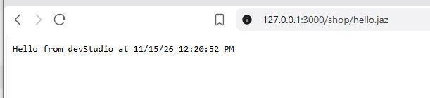

# FoxDev Studio HTTP Server Sample

A small Visual FoxPro web server written for **FoxDev Studio**. It shows how to:

- register routes with `LAMBDA ... ENDLAMBDA`
- read query strings, headers, route parameters and a JSON body
- answer with text or JSON and set status codes and headers
- send every other URL to a `Process` class through a catch-all route

## Files

| File | Purpose |
|---|---|
| `RunServer.prg` | Entry point (the project's main program): loads the procedures and starts the server |
| `Server.prg` | Creates the server, registers the routes, starts listening; also holds the helpers `RunProcess`, `WriteLog` and `JsonEscape` |
| `Process.prg` | `Process` class that answers the catch-all route, one method per action |
| `FoxDevProjects.fxproject` | FoxDev Studio project file |

## Running it

1. Open `FoxDevProjects.fxproject` in FoxDev Studio.
2. Run the project (main program `RunServer.prg`).
3. The screen shows `Listening on http://127.0.0.1:3000`.
4. Cancel the program in the studio to stop the server.

To use another port, call `DO Server WITH 8080`.

`Listen()` does not block: the program ends straight away and the routes keep
answering until the program is cancelled.

## Routes

| Method | URL | Answer |
|---|---|---|
| GET | `/` | Status JSON with the server time |
| GET | `/api/welcome` | Plain text welcome |
| GET | `/api/search?q=foxpro&limit=10` | JSON search result, 400 when `q` is missing |
| POST | `/api/session/login` | JSON body `{"username": "admin", "password": "secret"}`, answers 200, 400 or 401 |
| GET | `/api/secure/dashboard` | 401 without an `Authorization` header, JSON data with one |
| GET, POST | anything else | Handed to the `Process` class |

Try it with curl:

```bash
curl http://127.0.0.1:3000/
curl "http://127.0.0.1:3000/api/search?q=foxpro&limit=10"
curl -X POST http://127.0.0.1:3000/api/session/login -d "{\"username\": \"admin\", \"password\": \"secret\"}"
curl -H "Authorization: Bearer demo" http://127.0.0.1:3000/api/secure/dashboard
curl http://127.0.0.1:3000/hello.jaz
```

The login check and the session id are for demonstration only: the
credentials are hardcoded and nothing is stored or verified afterwards.

## The catch-all route and the Process class

```foxpro
loServer.Get("/*path", LAMBDA(req, res)
	RunProcess(req, res)
ENDLAMBDA)
```

- `*path` takes the rest of the URL. The wildcard **must have a name**:
  `"/*"` is refused when the route is registered.
- `:name` matches a single path segment (`/user/:id`), so `"/:path*"` is not a catch-all.
- Exact routes win over the catch-all whatever the order they were registered in.
- `/` itself is not matched by `/*path`, so it keeps its own route.

`Process.HandleRequest()` takes the action from `?action=name` when given,
otherwise from the script name of the path without folder and extension.
`/hello`, `/hello.jaz`, `/shop/hello.jaz` and `/anything?action=hello` all run
`SayHello`; an unknown action answers 404 JSON.



To add an action, add a `CASE` in `HandleRequest` and a method for it:

```foxpro
CASE lcAction == "customers"
	This.Customers()
```

If `Process` raises an error, `RunProcess` writes it to the screen and answers
500, unless a response was already sent.

## FoxDev Studio API used

**Server** - `FoxScript.Http.CreateServer()`

| Member | Use |
|---|---|
| `Get`, `Post`, `Put`, `Patch`, `Head`, `Options` | `loServer.Get("/route", LAMBDA(req, res) ... ENDLAMBDA)` |
| `Listen(nPort)` | Start answering; binds `127.0.0.1` only |

**Request** - `req`

| Member | Kind | Value |
|---|---|---|
| `Method` | property | `"GET"`, `"POST"`, ... |
| `Path` | property | URL path |
| `Body` | property | raw body as text |
| `Query("name")` | method | query string value, `""` when absent |
| `Params("name")` | method | route parameter, for example `Params("path")` |
| `Header("name")` | method | request header, case does not matter, `""` when absent |

`Query`, `Params` and `Header` are **methods**: `req.query.q` or
`req.headers["x"]` give "Unknown member".

**Response** - `res`

| Member | Use |
|---|---|
| `Status(nCode)` | HTTP status, 200 by default |
| `Header("name", "value")` | Response header |
| `Send(cText)` | Send the body, content type `text/plain` unless set with `Header` |
| `Json(cText)` | Send the body, content type `application/json` |
| `Sent` | `.T.` once a body was sent; a response can only be sent once |

To answer HTML, set the content type before sending:

```foxpro
res.Header("content-type", "text/html; charset=utf-8")
res.Send("<h1>Hello from FoxDev</h1>")
```

**JSON** - `FoxScript.Json.Parse(cText)` reads a JSON body (used by the login route).

## Notes and gotchas

- `LPARAMETERS` is not allowed inside a `LAMBDA`; the parameters go in `LAMBDA(req, res)`.
- `DO CASE` takes `CASE`, not `WHEN`.
- The lambdas run after `Server.prg` has ended, so `Server.prg` keeps itself and
  `Process.prg` loaded with `SET PROCEDURE ... ADDITIVE` for the helpers they call.
- The server only listens on `127.0.0.1`. To reach it from other machines, put a
  reverse proxy (IIS URL Rewrite + ARR, nginx, ...) in front of it.

## License

This project is licensed under the [MIT License](LICENSE).
